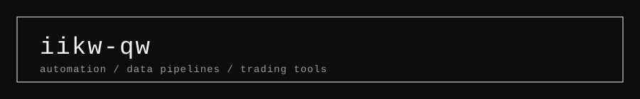

I work with data and build automation: analytics, forecasting and machine learning in Python, plus browser automation, media processing and test infrastructure.

## Analytics

| Repository | Description |
|------------|-------------|
| [ecommerce-sales-analysis](https://github.com/iikw-qw/ecommerce-sales-analysis) | Sales KPI analysis for an online shop: revenue trends, category mix, Pareto concentration, discount effect |
| [cohort-retention-analysis](https://github.com/iikw-qw/cohort-retention-analysis) | Monthly signup cohorts, retention matrix and heatmap, average retention curve |
| [ab-test-toolkit](https://github.com/iikw-qw/ab-test-toolkit) | Small library for analysing online experiments: z-test, Welch t-test, bootstrap, sample size, SRM check, CUPED |
| [rfm-customer-segmentation](https://github.com/iikw-qw/rfm-customer-segmentation) | RFM scoring and rule-based customer segments, compared with KMeans clusters |
| [marketing-funnel-analysis](https://github.com/iikw-qw/marketing-funnel-analysis) | Conversion funnel by channel and device, biggest drop-off, significance test and revenue impact of a fix |
| [sql-analytics-warehouse](https://github.com/iikw-qw/sql-analytics-warehouse) | Small SQLite warehouse with analytical SQL: window functions, ranking, retention and market-basket queries |
| [subscription-metrics](https://github.com/iikw-qw/subscription-metrics) | SaaS metrics from monthly MRR snapshots: MRR waterfall, churn, net and gross revenue retention, LTV, quick ratio |
| [price-elasticity-analysis](https://github.com/iikw-qw/price-elasticity-analysis) | Price elasticity by product category with log-log regression, fixed effects and pricing recommendations |
| [hr-attrition-analysis](https://github.com/iikw-qw/hr-attrition-analysis) | Employee attrition drivers: group rates, hypothesis tests with multiple-comparison correction, odds ratios, risk quintiles |

## Data science

| Repository | Description |
|------------|-------------|
| [retail-demand-forecast](https://github.com/iikw-qw/retail-demand-forecast) | Daily demand forecasting with rolling-origin backtesting: seasonal naive, Holt-Winters and a calendar regression |
| [sensor-anomaly-detection](https://github.com/iikw-qw/sensor-anomaly-detection) | Anomaly detection on multivariate sensor streams: robust z-score on residuals, Isolation Forest, event-level evaluation |
| [clv-prediction](https://github.com/iikw-qw/clv-prediction) | Customer lifetime value prediction: features from a calibration window, spend in the next 12 months as target |
| [market-basket-analysis](https://github.com/iikw-qw/market-basket-analysis) | Frequent itemsets and association rules with a from-scratch Apriori, plus a simple next-item recommender |
| [review-text-mining](https://github.com/iikw-qw/review-text-mining) | Customer review mining: sentiment classifier against a lexicon baseline, topic discovery with NMF |
| [uplift-modeling](https://github.com/iikw-qw/uplift-modeling) | Uplift modeling on a randomised campaign: T-learner, uplift by decile, Qini curve, profit by targeted share |
| [delivery-geo-clustering](https://github.com/iikw-qw/delivery-geo-clustering) | Geospatial clustering of delivery points: haversine distance, KMeans depot placement, DBSCAN dense zones |
| [survival-analysis-churn](https://github.com/iikw-qw/survival-analysis-churn) | Survival analysis of customer churn with censoring: Kaplan-Meier, log-rank test, Cox proportional hazards |

## Machine learning

| Repository | Description |
|------------|-------------|
| [credit-default-scoring](https://github.com/iikw-qw/credit-default-scoring) | Credit default model: logistic regression against gradient boosting, calibration, KS, decile lift and a cost-based threshold |
| [house-price-regression](https://github.com/iikw-qw/house-price-regression) | House price regression with cross-validation, log-target models, permutation importance and prediction intervals |
| [telecom-churn-pipeline](https://github.com/iikw-qw/telecom-churn-pipeline) | End-to-end churn model: sklearn pipeline, cross-validation, permutation importance, campaign profit and a saved model |
| [fraud-detection](https://github.com/iikw-qw/fraud-detection) | Card fraud detection on highly imbalanced data: time-based split, class weights, undersampling, precision at an alert budget |
| [movie-recommender](https://github.com/iikw-qw/movie-recommender) | Collaborative filtering from scratch: popularity, bias model and ALS matrix factorisation, with ranking metrics |
| [digit-classifier](https://github.com/iikw-qw/digit-classifier) | Handwritten digit classification: kNN, random forest, MLP and tuned SVM with error analysis and robustness checks |
| [feature-selection-benchmark](https://github.com/iikw-qw/feature-selection-benchmark) | Feature selection methods compared on data with known noise: filters, L1, RFE and forest importance, with stability |
| [hyperparameter-search](https://github.com/iikw-qw/hyperparameter-search) | Grid, random and successive-halving search compared on cost and result, plus return on search budget |
| [model-drift-monitoring](https://github.com/iikw-qw/model-drift-monitoring) | Monitoring a deployed model: PSI, KS and chi-square drift tests, weekly AUC tracking and alert rules |

## Tools and automation

| Repository | Description |
|------------|-------------|
| [viralforge](https://github.com/iikw-qw/viralforge) | Text to vertical video: TTS, karaoke subtitles, ffmpeg, YouTube API upload |
| [marketposter](https://github.com/iikw-qw/marketposter) | Draft generator for affiliate posts from Yandex Market products |
| [qa-test-factory](https://github.com/iikw-qw/qa-test-factory) | Producer/consumer harness for seeding and load-testing staging APIs |
| [yandex-games](https://github.com/iikw-qw/yandex-games) | Ten HTML5 games and a publishing helper for Yandex Games |

## Stack

Python, pandas, NumPy, scikit-learn, statsmodels, SciPy, SQL, Playwright, Selenium, ffmpeg, SQLite, MongoDB, RabbitMQ, Docker, JavaScript, MQL5.
